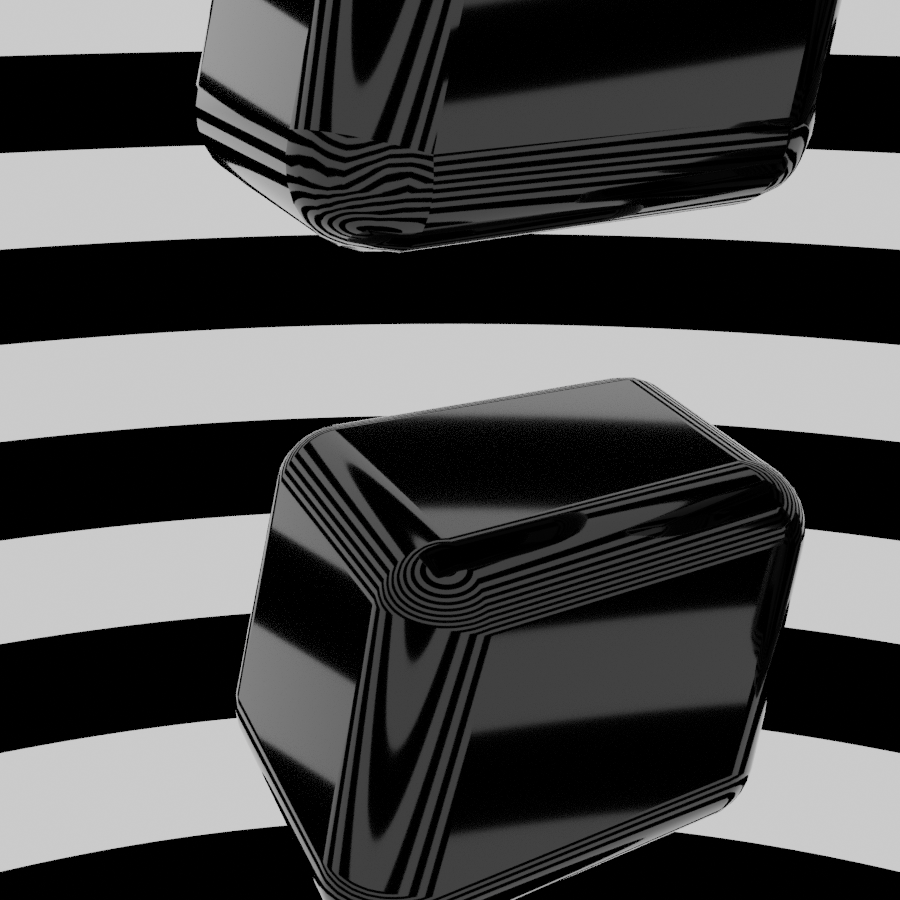
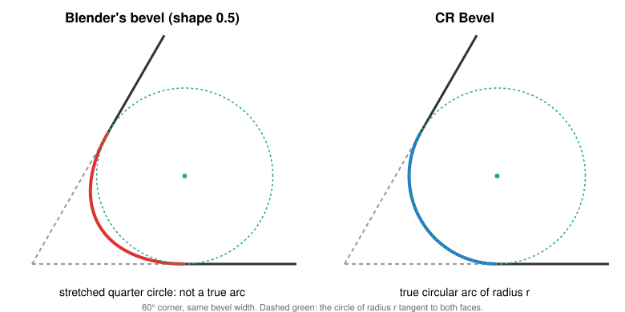
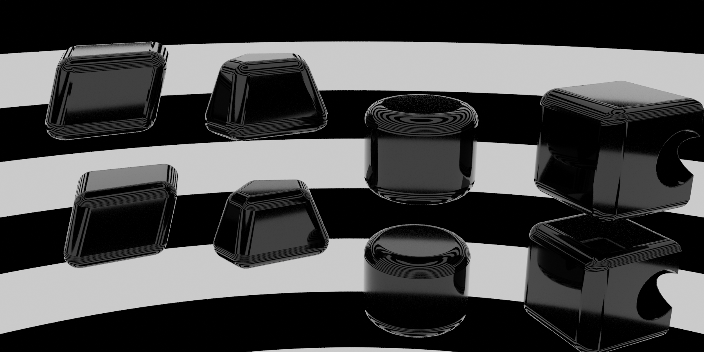

# CR Bevel — constant-radius bevel for Blender

**CR Bevel** is a Geometry Nodes modifier for Blender 5.2+ that rounds edges with a **true constant radius**, like the fillet tool in CAD software. Every rounded edge is an exact circular arc of the radius you type, every corner where three rounded edges meet is an exact sphere, and the shading follows the true curved surface.

**[⬇ Download the latest release](https://github.com/baguotti/blender_constant_radius_bevel/releases/latest)** · Blender 5.2 LTS or newer · Free and open source (GPL-3.0-or-later)



*The same object with Blender's own bevel (top) and CR Bevel (bottom), in a mirror-like material reflecting stripes. A true round shows smooth, evenly spaced stripes and clean rings at the corner; the native bevel's stripes wobble and bunch.*

---

## Contents

- [Why CR Bevel?](#why-cr-bevel)
- [Features](#features)
- [Install](#install)
- [Quick start](#quick-start)
- [Settings](#settings)
- [Choosing which edges are rounded](#choosing-which-edges-are-rounded)
- [Tips and workflows](#tips-and-workflows)
- [What is exact, and what isn't](#what-is-exact-and-what-isnt)
- [Known limitations](#known-limitations)
- [Troubleshooting / FAQ](#troubleshooting--faq)
- [How it works](#how-it-works)
- [Development](#development)
- [Credits and license](#credits-and-license)

---

## Why CR Bevel?

Blender's Bevel (modifier, tool and node) builds a quarter-circle profile as if every corner were 90°, then stretches it to fit the real angle. On any edge that isn't 90°, the result is an elliptical arc, so the "radius" varies along the profile and from edge to edge. The sharper the edge, the further off it is: about 1.5% of the radius at 120°, 12% at 60°, 31% at 45°.



In the real world, a fillet or a router bit has one radius, and it's the same on every edge whatever the angle. CR Bevel gives you exactly that, which matters for:

- **Product, industrial and CAD-style models**, where fillets are specified by radius.
- **Close-ups and reflective materials**, where a non-circular profile shows up as wobbly highlights.
- **Consistency:** the same radius on a 90° edge and a 130° edge looks like the same tool made it.

It builds on Blender's own Mesh Bevel node (new in Blender 5.2), so the topology is the familiar one; CR Bevel makes the geometry exact.



## Features

- **Exact constant radius on every edge**, convex and concave, from about 4° to 180° between faces.
- **Exact corners:** a true sphere where three rounded edges meet, the true intersection where two meet, and clean ends where a rounded edge stops at an unrounded face, even a slanted one.
- **Open meshes too:** a rounded edge that runs out at an open border (a mesh with missing faces) stays exact, ending in the plane of the missing face.
- **Polylines:** corners of loose edges (wires without faces) are rounded with true arcs of the same radius, like the Bevel modifier's *Vertices* mode.
- **Exact shading:** custom normals follow the true surface, original faces keep your smooth/flat shading, and normals survive deforming modifiers placed afterwards (armatures, lattices…).
- **Overlap clamp:** lowers the radius where a bevel would overlap itself, either uniformly (keeps one radius) or per edge, with a warning on the modifier when it does.
- **Safe on messy meshes:** boolean results, triangles, open boundaries, imported meshes with custom normals. Where no exact answer exists, it keeps Blender's native bevel there instead of guessing.
- **A proper modifier:** non-destructive, animatable (keyframe the radius), works in Edit Mode, after Mirror, Array and Subdivision, and can be applied.
- **Optional bevel material**, plus a `cr_bevel_face` attribute marking the new faces for your own shading or nodes.

## Install

1. Download **`cr_bevel-<version>.zip`** from the [latest release](https://github.com/baguotti/blender_constant_radius_bevel/releases/latest). Don't unzip it.
2. In Blender, open **Edit > Preferences > Get Extensions**.
3. Click the **drop-down arrow** at the top right and choose **Install from Disk…**, then pick the zip.
4. Make sure **CR Bevel** is enabled in the list.

**Requirements:** Blender **5.2 LTS or newer**. It relies on the Mesh Bevel node, which doesn't exist in earlier versions.

**To update:** install the newer zip the same way. Files that already use CR Bevel keep their own copy of the node group, so they don't change until you add CR Bevel again (see the [FAQ](#troubleshooting--faq)).

**Without the extension (Asset Browser):** download or clone this repository, then add its `library/` folder under **Edit > Preferences > File Paths > Asset Libraries**. CR Bevel then appears in the Add Modifier menu and the Asset Browser.

## Quick start

1. Select one or more mesh objects.
2. **Properties > Modifiers > Add Modifier > Generate > CR Bevel.**
3. Set **Radius** (in the object's units) and **Segments** (how smooth the rounds are).
4. Done: every edge sharper than **Angle Limit** (30° by default) is rounded. To round only edges you marked, switch **Edges** to Bevel Weight, Sharp Edges or Seams.

**Scaled objects:** like Blender's Bevel modifier, **CR Bevel** measures the radius in the object's own units, and a non-uniform scale stretches the rounds into ellipses. Either apply the scale (**Ctrl+A > Scale**), or add **CR Bevel (Scene Units)** instead (same menu): the radius is in scene units and the rounds stay circular at any scale, also non-uniform or from a scaled parent. Its one cost: because it follows the object's scale, Blender re-evaluates it whenever the object moves, which you'll notice when dragging very heavy objects.

## Settings

| Setting | Default | What it does |
| --- | --- | --- |
| **Edges** | Angle | Which edges to round: **Angle** (sharper than Angle Limit), **Bevel Weight** (edges with a bevel weight, each at Radius × its weight), **Sharp Edges** (Mark Sharp) or **Seams** (Mark Seam). See [below](#choosing-which-edges-are-rounded). |
| **Selection** | All | An extra mask on top of Edges. Click the icon next to it to drive it from an attribute. |
| **Radius** | 0.05 m | The fillet radius, in the object's units (in scene units with **CR Bevel (Scene Units)**). With Edges: Bevel Weight, each edge uses Radius × its weight. |
| **Segments** | 4 | Number of faces across each round (1–256). |
| **Angle Limit** | 30° | Edges: Angle only. Only edges whose faces meet at more than this angle are rounded; flat or gently curved areas are left alone. Set it to 0° to allow every selected edge. |
| **Clamp** | Uniform | How to avoid overlapping bevels when the radius is too large for the geometry. **Uniform** lowers the radius everywhere just enough, so it stays constant (CAD-like). **Per Edge** lowers it only on edges that need it, best for boolean results and busy models. **None** applies the radius as typed and may overlap. A warning on the modifier tells you when, and by how much, the radius was lowered. |
| **Wire Corners** | On | Round the corners of loose edges (polylines without faces) with arcs of radius r, like Bevel's *Vertices* mode. Open ends stay where they are; branch points (3 or more wires) aren't rounded. |
| **Shading > Analytic Normals** | On | Exact shading normals on the rounds; original faces keep their own smooth/flat shading. Turn it off for about 35% more speed while modelling heavy scenes. |
| **Shading > Set Bevel Material / Bevel Material** | Off | Give the new bevel faces a material of their own. |
| **Advanced > Exact Profile** | On | Off shows Blender's native profile, for comparison. |

**Output attribute:** `cr_bevel_face` (face, boolean) is true on the new bevel and corner faces. Use it in shaders (Attribute node) or later Geometry Nodes.

## Choosing which edges are rounded

Pick a rule with **Edges**; **Selection** is an extra mask on top of it.

- **Angle** (default): every edge sharper than **Angle Limit**, e.g. 30°.
- **Bevel Weight:** in Edit Mode, set bevel weights on edges (**Edge menu (Ctrl+E) > Edge Bevel Weight**, or the N panel). Every edge with a weight above 0 is rounded, at **Radius × weight**, so a weight of 0.5 gives half the radius, as in Blender's Bevel modifier. **Clamp Uniform** keeps the ratios: if the radius must be lowered, all weighted edges shrink together.
- **Sharp Edges:** edges marked with **Mark Sharp** (Ctrl+E), also those set by a *Smooth by Angle* modifier placed before CR Bevel.
- **Seams:** edges marked with **Mark Seam**.
- **Any attribute:** with Edges on Angle and Angle Limit at 0°, drive **Selection** from a boolean or float edge attribute, for example one painted or generated by other nodes.

Angle Limit is ignored in the three marked modes, so shallow marked edges are rounded too. If nothing is marked, a warning on the modifier says so. Polylines (Wire Corners) follow the same rule: a polyline corner gets Radius × the mean weight of its two pieces.

## Tips and workflows

- **Boolean / hard-surface models:** use **Clamp: Per Edge**. Uniform keeps one radius everywhere, so a single tight spot (a sliver from a boolean) lowers it for the whole object.
- **Stacking:** put CR Bevel after modifiers that create the edges (Boolean, Mirror, Array), and before Subdivision if you want subdivided rounds.
- **Animation:** the radius and segment count can be keyframed. Normals stay correct under later deform modifiers.
- **Applying:** applying the modifier keeps the exact geometry, the custom normals and the `cr_bevel_face` attribute.
- **Performance:** with every edge of an 81,000-face mesh beveled (2 million faces out) it takes about 1.8× Blender's native bevel, almost all of it Blender's encoding of the exact normals; with Analytic Normals off, about 1.2×. On typical models, where only the sharp edges are beveled, the overhead is much smaller. For interactive work on heavy scenes, turn Analytic Normals off or lower Segments. Details: [docs/PERFORMANCE.md](docs/PERFORMANCE.md).
- **Two rounds:** two CR Bevel modifiers can be stacked, for example a large radius on main edges and a small one on everything.

## What is exact, and what isn't

CR Bevel is exact wherever the exact rolling-ball answer fits Blender's bevel topology, and keeps the native bevel elsewhere. It never guesses.

| Situation | Result |
| --- | --- |
| Edge between two faces (any angle from about 4° to 180°, convex or concave) | Exact circular arc |
| Corner where 3 rounded edges with the same radius meet (box corners, any angles) | Exact sphere |
| Two rounded edges meeting (chain, cylinder rim) | Exact intersection of the two rounds |
| Rounded edge continuing straight through extra vertices | Exact |
| Rounded edge ending at an unrounded face, also slanted | Exact, and the end stays flat in that face |
| Rounded edge ending at an open border (missing faces) | Exact, ending in the plane of the missing face |
| Corners of polylines (loose edges, Wire Corners) | Exact circular arcs |
| 4 or more rounded edges at one vertex, mixed convex/concave corners, different radii meeting (Per Edge, or different bevel weights) | Native bevel kept at that corner |
| Corners, joints or ends at vertices with more than 3 faces (e.g. triangulated) | Native bevel kept |
| Edges sharper than 4° between faces (knife edges) | Not rounded: the exact arc would be thinner than floating-point precision |
| Rounded edge ending against a face within 4° of parallel to it (e.g. one weighted edge on a curved rim) | Native shape kept at that end: the exact end would lie far away |

Accuracy, where exact: positions to about a millionth of the radius. Normals to about 0.003°, the precision Blender stores custom normals at.

## Known limitations

- **Thin walls between a hole and an outer edge** (typical after booleans): with a large radius, bevels can still collide across the wall even with Clamp. The clamp prevents overlaps within each face, but not between two separate parts of a face's border. Blender's own Bevel clamp has the same gap. Lower the radius there, or use Per Edge.
- **Where the native bevel is kept** (see the table above), its profile isn't a true arc. It still blends cleanly with the exact parts.
- **One joint vertex** next to an unrounded edge, where two rounded edges with different angles meet, can't be exact with this topology. It stays within a few percent of the radius.
- **Instances** from Geometry Nodes pass through unrounded; only the mesh part of the input is beveled. Add a *Realize Instances* node before CR Bevel if you need them rounded.
- **Input custom normals are replaced:** a bevel invalidates them anyway. With Analytic Normals off, shading comes from your smooth/flat settings and sharp edges.
- **Faces pointing the wrong way:** edges between faces with inconsistent normals are not rounded, and a warning tells you to **Recalculate Normals** (Edit Mode, **Shift+N**).

## Troubleshooting / FAQ

**Nothing happens.**
- Edges must be sharper than **Angle Limit**.
- Radius must be above 0.
- If you switched Selection to an attribute, check the attribute's name.
- On meshes with faces, only edges between exactly two faces are rounded (border edges of open meshes aren't). Edges without any faces are polylines: their corners are rounded by **Wire Corners**.

**There's a warning "N edge(s) clamped…".** The radius was too large for some edges and was lowered to avoid overlaps. The message gives the smallest radius actually used. Lower the radius, or switch to **Per Edge** so only those edges shrink.

**There's a warning "Some faces point the wrong way…".** Fix the normals: Edit Mode, select all, **Shift+N** (Recalculate Outside).

**The round looks faceted.** Raise **Segments**, and keep **Analytic Normals** on.

**Weird shading after a deform modifier.** Make sure CR Bevel comes before the deform modifier in the stack. Its normals follow later deformations.

**I updated the extension but my file still behaves like the old version.** Each file keeps the CR Bevel node group it was made with, so your files don't change unexpectedly. To use the new version in an old file, delete the old "CR Bevel" node group (or rename it), then add the modifier again.

**Is it slower than Blender's bevel?** Somewhat: up to about 1.8× with every edge beveled, about 1.2× with Analytic Normals off, less on typical models. Clamp Per Edge costs little extra since 1.0.6. See [Tips](#tips-and-workflows).

## How it works

For each selected edge, CR Bevel computes the offset `d = r · tan(φ/2)` (φ = angle between the two face normals). That is exactly where a circle of radius r touches both faces. These offsets go into Blender's Mesh Bevel node, which builds the topology.

It then builds a "skeleton" of the rounds' axes (the lines the rolling ball's centre travels along) and cuts them where they meet, at the ball centres. Every new vertex is moved to `Q + r · normalize(p − Q)`, where Q is the nearest point on that skeleton. This is the exact definition of rolling a ball of radius r along the edges: shrink the solid by r, then grow it back by r. Special rules cover joints, and ends that stop at a face. Finally the exact surface normals are written as custom normals.

Each original vertex is classified (end, straight continuation, joint, corner, or fallback). Only layouts with a provably exact answer are snapped; everything else keeps the native result.

Full details, the math, and every measurement are in [`docs/`](docs/):
- [PLAN.md](docs/PLAN.md): design and math
- `PHASE0`–`PHASE4_FINDINGS.md`: measurements per development phase
- [REVIEW_FINDINGS.md](docs/REVIEW_FINDINGS.md): seven bug-hunting passes, with fuzzing and an independent oracle

## Development

Everything is generated from Python scripts. Never hand-edit the `.blend` files.

| Path | Contents |
| --- | --- |
| `src/build_cr_bevel.py` | The only place the node group is defined |
| `src/make_library.py` | Builds `library/cr_bevel_library.blend` |
| `src/make_extension.py` | Builds the installable `dist/cr_bevel-<version>.zip` |
| `extension/` | Extension manifest and the small add-on (the Add Modifier menu entry) |
| `tests/` | Test suites, the shared analytic reference (`analytic.py`), and results |
| `docs/` | Plan, findings, images |

Build and test (headless, Blender 5.2+ on your PATH):

```bash
blender -b --factory-startup --python src/make_extension.py
```

```bash
for t in phase1 phase2 phase3 phase4 robustness oracle fuzz lifecycle; do blender -b --factory-startup --python tests/test_$t.py || echo "FAILED: $t"; done
```

**What the suites check:**
- **Phases 1–4:** strips, corners, clamp, normals and the extension.
- **robustness:** awkward inputs.
- **oracle:** an independent check that every vertex lies exactly one radius from the shrunk solid, computed without any of the node's own code.
- **fuzz:** random shapes with fixed seeds.
- **lifecycle:** save and reopen, apply, stacking, keyframes, linking, Edit Mode.

Shading renders come from `tests/render_phase3.py`; look at them after any visual change.

**Releasing a new version:**
1. Bump `version` in `extension/blender_manifest.toml`.
2. Add `docs/release_notes/vX.Y.Z.md`.
3. Push a tag `vX.Y.Z`, or run the **Release** workflow from the Actions tab.

GitHub Actions then downloads Blender 5.2 LTS, builds the zip from source, runs the install test and publishes the release with the zip attached.

## Credits and license

Inspired by the 2019 [Bevel Constant Radius project](https://devtalk.blender.org/t/fall-2019-bevel-constant-radius-project/9872) by Hans Goudey, and built on the Mesh Bevel node by Howard Trickey (Blender 5.2).

Licensed under the **GNU General Public License v3.0 or later**: see [LICENSE](LICENSE).
